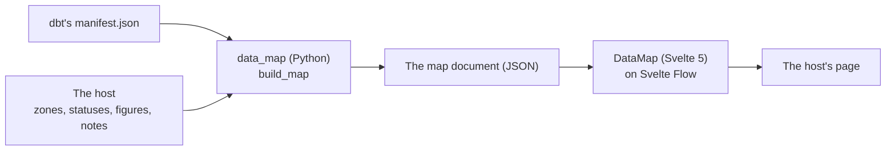

# Architecture — overview

The way into data-map: what it is, how it is laid out, and where each subject is documented.

- What it does, and what proves it: [docs/features.md](docs/features.md)
- Why it is built so: [docs/decisions.md](docs/decisions.md)
- The map document, its fields and its tokens: [docs/format.md](docs/format.md)
- What broke and what we learnt: [docs/defects.md](docs/defects.md)
- What is left: [docs/roadmap.md](docs/roadmap.md)

## Purpose and scope

A map of a dbt project's tables for the people who read them, embedded in a host's page. data-map draws and
describes; it does not run checks nor query the warehouse: the host says what is sound.

## The system

Two halves share one contract, the map document: the producer depends on nothing of the component, the
component on nothing of the producer. A host may produce the document another way, or draw it another way.

## Repository map — organised by function

| Path | Family | Holds |
|---|---|---|
| `data_map/` | format, producer | `document.py`: the map document, the format's one source; `manifest.py`: what is read in dbt's manifest; `links.py`: the lineage collapsed onto the nodes shown; `build.py`: a document from the host's zones and the manifest |
| `format/` | format | `map.schema.json` (GENERATED from `document.py`), `example.map.json` (a fictitious shop, used by the tests and the demo) |
| `component/` | component | `DataMap.svelte` (the switches, the lineage in words, the detail), `FlowMap.svelte` (Svelte Flow), `FlowNode.svelte`, `ZoneTitle.svelte`, `NodeDetail.svelte`, `StatusMark.svelte`; `layout.ts`, `lineage.ts`, `labels.ts`, `tokens.css`; `document.ts` (GENERATED); `index.ts` (what is exposed) |
| `demo/` | component | The component on the example map, as a host mounts it (`npm run dev`) |
| `tests/` | all | `format/`, `producer/`, `component/` (vitest), `tools/`, `fixtures/manifest.json` (fictitious) |
| `tools/` | guards | `hooks.py` and `checks.py` (the hooks and CI), `build_format.py` (the generated files), `build_defects.py`, `check_features.py`, `check_file_size.py`, `check_links.py`, `watch_ci.py` (the CI run of the pushed commit) |
| `docs/` | documentation | One page per subject, each linking back here |

The Python package sits at the root, not in a family folder: packaging imposes one importable folder, and it holds
both the format and the producer. `package.json` and `pyproject.toml` sit side by side at the root, so either
half installs from a git tag. The generated files (listed in `tools/build_format.py`) say so in their first lines
and are checked up to date before each commit and in CI.

## Principles of design

How the rules shared by the author's projects apply here:

- **One source per fact**: the format in `document.py`, its schema and types generated; the words in
  `labels.ts`; the colours in `tokens.css`; the layout's dimensions in `layout.ts`'s `LAYOUT`.
- **Dependencies inverted**: the producer receives the manifest and the host's zones, it reads no file of its own
  choosing; the component receives a document. Neither knows the host.
- **Reuse before building**: Svelte Flow draws; dbt's manifest is read, not dbt run (decisions.md).
- **Accessible from the start**: axe on the map, the contrasts from the tokens, a status always an icon and a
  word.
- **Checked, not declared**: the same guards before each commit, each push and in CI; every test carries the
  features it proves; every defect has its entry and its test.
- **No real data**: the fixture and the example are a fictitious shop; nothing from a host's data enters this
  repository.
- **One contract**: a change to the map document regenerates its schema and types
  (`uv run python tools/build_format.py`), raises `FORMAT_VERSION` when a host would break, and is recorded in
  `docs/decisions.md`.
- **The host owns its data**: data-map never runs checks nor queries a warehouse.
